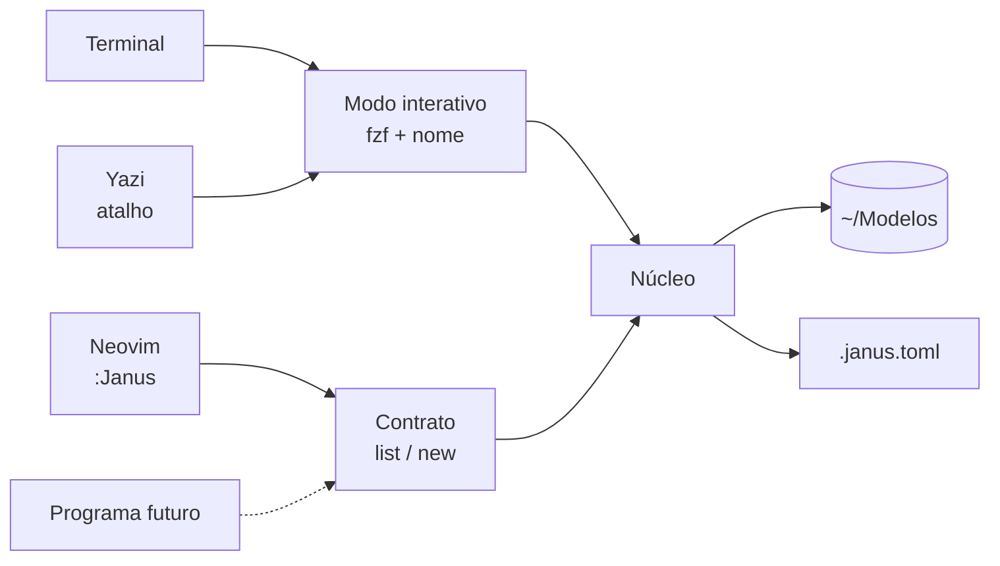

# Janus

Ferramenta de linha de comando que leva o "Criar novo documento" do gerenciador de arquivos para o terminal, o yazi e o neovim, usando a mesma pasta de modelos (`~/Modelos`) que o Nemo já usa.

O nome vem do deus romano dos começos e das passagens, de duas faces: a mesma pasta de modelos vista pela interface gráfica e pelo terminal.

## Sobre este documento

- **O que é**: a especificação de design completa do Janus e o ponto de partida deste repositório. Não há outra spec a escrever antes do código. O próximo artefato é o plano de implementação de [[roadmap|RM-01.01]], em `docs/plans/`.
- **Para quem**: quem for escrever o plano e o código, sem acesso à conversa que originou as decisões. Tudo o que foi decidido está registrado, com o motivo.
- **Origem**: a ideia amadureceu na "incubadora", um repositório de notas onde o autor registra ideias antes de criar o projeto. O desenho saiu de uma sessão de brainstorming com o Claude Code em 2026-11-09, e foi migrado para cá no mesmo dia.
- **Onde está o resto**: os termos, com o nome em inglês de cada um, em [[glossary]]; as decisões, com motivo e alternativas rejeitadas, em [[decisions]]; as entregas, em [[roadmap]]; o que ficou para depois, em [[technical-debts]].
- **O que está em aberto**: só o que aparece em [[technical-debts]].

O que foi conferido e o que não foi:

| Afirmação | Situação |
|---|---|
| Versões e caminhos de [[#Ambiente de referência]] | Lidos na máquina do autor em 2026-11-09 |
| [[#Inventário dos modelos]] | Lido na máquina do autor em 2026-11-09 |
| Sintaxe do atalho do yazi (`mgr.prepend_keymap`, `shell --block`) | Executada pelo autor na yazi 26.9.1 em 2026-11-16, com os cinco passos do roteiro manual ([[technical-debts\|DT-03]], resolvida), e de novo em 2026-11-19, com os sete passos ([[rm-01.02-manual-check]]). Os passos 1 a 6 rodaram no terminal do autor, com o arquivo de `integrations/yazi/` instalado pelo dotfiles. O passo 7 e o `janus --hold` de cada passo rodaram num `tmux` automatizado, em que o `shell --block` não roda por falta de um terminal de verdade ([[technical-debts\|DT-16]]) |
| O Nemo não mostra itens ocultos no menu de modelos | Confirmado pelo autor em 2026-11-09 para a pasta oculta `.git`; o manifesto, também oculto, segue a mesma regra ([[technical-debts\|DT-01]], resolvida) |
| Bibliotecas e opções citadas em [[#Notas para o plano de implementação]] | As escolhidas foram conferidas na documentação em 2026-11-16: `BurntSushi/toml` 1.6.0 ([[decisions#DE-18 — O manifesto é lido com BurntSushi/toml\|DE-18]]) e as opções do `fzf` 0.74 usadas no campo de nome e na prévia ([[decisions#DE-17 — O campo de nome é o próprio fzf\|DE-17]]) |
| Como a GLib lê o `user-dirs.dirs` | Código de `glib/gutilsprivate.c` lido em 2026-11-16 ([[decisions#DE-20 — O user-dirs.dirs é lido como a GLib lê\|DE-20]]) |

## Problema

No GNOME, o Nemo oferece "Criar novo documento" no botão direito: escolhe-se um modelo da pasta `~/Modelos` e ele nasce na pasta atual. Fora da interface gráfica esse recurso não existe, e isso gera três atritos:

- **Troca de contexto**: para usar um modelo estando no terminal, é preciso abrir o Nemo, navegar até a pasta, criar o arquivo pela interface e voltar.
- **Renomear à mão**: o autor confirmou que o destino do nome varia por modelo. Alguns têm sempre o mesmo nome final e são renomeados para ele a cada uso (`allsoft.ai-memory.toml` vira `.ai-memory.toml`, `react.AGENTS.md` vira `AGENTS.md`, `package.json.monorepo` vira `package.json`). Outros recebem um nome novo a cada uso (`01.0. Petição Inicial.tex` vira o nome da peça do cliente).
- **Sem equivalente no yazi e no neovim**, que são as outras interfaces de uso diário.

## Solução em uma frase

Um núcleo único em linha de comando que conhece a pasta de modelos e as regras de nome, exposto por um contrato pequeno (`list` e `new`) que o terminal, o yazi, o neovim e qualquer programa futuro consomem por adaptadores de poucas linhas.

## Projeto

### Identidade

| Item | Valor |
|---|---|
| **Dono** | Darth Gama Software (`owner: darth-gama-software` em `catalog-info.yaml`) |
| **Autor** | Roberto Gama |
| **Repositório local** | `~/Projetos/dev/janus/janus`, o worktree da branch `main`. Criado em 2026-11-09. |
| **Remoto e módulo Go** | Remoto `git@gitlab.com:rg-dev/janus.git`; módulo `gitlab.com/rg-dev/janus`. Trocar um exige trocar o outro no mesmo commit ([[decisions#DE-16 — O módulo Go é gitlab.com/rg-dev/janus\|DE-16]]). |
| **Plataforma** | Linux. Nenhuma outra é alvo. |
| **Licença** | Nenhuma enquanto o repositório for privado. Entra em pauta só se houver publicação. |

### Padrões que se aplicam

O projeto segue os padrões da Darth Gama Software. O essencial, para quem não tiver o documento de padrões à mão:

- **Idioma**: identificadores, nomes de arquivo e pasta, branches e mensagens de commit em inglês. Comentários no código, mensagens ao usuário e conteúdo de `docs/` e do README em português do Brasil. Nomes de arquivo em `docs/` em inglês.
- **Commits**: `<gitmoji> tipo(escopo): descrição`, em inglês, imperativo, minúsculas, sem ponto final. Sem co-autoria de IA. Sem push sem pedido expresso. Os escopos usados neste projeto estão em [[decisions#DE-14 — Escopos de commit dentro do vocabulário da casa|DE-14]].
- **Branches**: `main` (estável), `dev` (integração), `feat/<slug>` e `fix/<slug>`. Cada branch é um worktree irmão em `~/Projetos/dev/janus/`, trocando `/` por `_` no nome da pasta. A exceção são as entregas do roadmap, em `feat/rm-NN.NN_<slug>`, no worktree que o herdr cria ([[decisions#DE-25 — A branch de entrega do roadmap leva o ID e mora no worktree do herdr|DE-25]]).
- **Documentação**: `docs/specs/`, `docs/plans/`, `docs/requirements/`, `docs/reports/`, `docs/decisions.md`, `docs/technical-debts.md` e `docs/roadmap.md`, em Markdown estilo Obsidian com frontmatter.
- **Dívida técnica**: tudo que ficar para depois vira uma `DT` antes de a tarefa terminar.
- **Testes**: moram ao lado do código que testam. Por regra do autor, a correção de um bug começa por um teste de regressão que falha antes da correção.

Os padrões da casa não têm referência para Go. As convenções de nome adotadas para o código Go estão em [[decisions#DE-13 — Código Go segue as convenções do Go; o resto, as da casa|DE-13]].

### Stack

- **Linguagem**: Go. A versão mínima é a instalada na máquina do autor, 1.27.
- **Artefato**: um único binário, `janus`.
- **Dependências**: biblioteca padrão primeiro. Dependências externas eram aceitas para duas necessidades que a biblioteca padrão não cobre: ler TOML e editar uma linha de texto com valor inicial. A primeira é `github.com/BurntSushi/toml` ([[decisions#DE-18 — O manifesto é lido com BurntSushi/toml|DE-18]]); a segunda não precisou de dependência, porque o campo de nome é o próprio `fzf` ([[decisions#DE-17 — O campo de nome é o próprio fzf|DE-17]]). Qualquer outra pede uma decisão registrada.
- **Programas externos em tempo de execução**: `fzf`, obrigatório só no modo interativo; `bat`, opcional, usado na prévia quando existir.

### Estrutura proposta do repositório

```
janus/
├── cmd/janus/            ← ponto de entrada do binário
├── internal/
│   ├── core/             ← descoberta, listagem, manifesto, nome final, cópia
│   ├── messages/         ← todo texto ao usuário, e o texto de cada erro tipado
│   ├── failure/          ← erros que não vêm do núcleo: uso incorreto, programa ausente, cancelamento
│   ├── cli/              ← argumentos, subcomandos, JSON, códigos de saída
│   ├── interactive/      ← modo interativo: seletor, campo de nome, prévia
│   └── testfixture/      ← a pasta de modelos de teste, usada pelos testes dos outros pacotes
├── integrations/
│   ├── nvim/             ← plugin Lua: plugin/janus.lua e lua/janus/init.lua
│   └── yazi/             ← trecho de keymap.toml e instruções
├── docs/                 ← estrutura padrão da casa
├── go.mod
└── README.md
```

### Instalação

`go install ./cmd/janus` a partir da raiz do repositório. O binário vai para `~/go/bin`, que já está no `PATH` do autor.

## Arquitetura

O princípio-guia é que **só o núcleo conhece os modelos**. Nenhum adaptador percorre a pasta de modelos nem interpreta o manifesto por conta própria: identificadores, nomes e conteúdo sempre vêm do Janus.



### Componentes

1. **Núcleo**: descobre a pasta, lista os modelos, lê o manifesto, resolve o nome final e copia. Não imprime nada, não lê do teclado e não conhece códigos de saída: devolve valores e erros tipados.
2. **Linha de comando**: os subcomandos `list` e `new`, a saída em JSON, a tradução de erros em códigos de saída. É o contrato estável. O texto das mensagens vem de um pacote próprio, compartilhado com o modo interativo ([[decisions#DE-21 — As mensagens moram em internal/messages|DE-21]]).
3. **Modo interativo**: o frontend de terminal. Chama as funções do núcleo diretamente, dentro do mesmo processo; não executa o próprio binário como subprocesso. O seletor e o campo de nome ficam cada um atrás de uma interface, para serem substituídos nos testes.
4. **Integrações**: o plugin do neovim e o trecho de configuração do yazi, cada um em sua pasta, com instruções de instalação.

### Dois níveis de integração

- **Trivial**: qualquer programa que consiga rodar um comando numa pasta reaproveita o modo interativo. É o caso do yazi.
- **Nativo**: o programa usa `list` e `new` com a própria interface. É o caso do neovim.

## Fluxos

### Terminal

1. O usuário roda `janus` na pasta de destino.
2. Abre o seletor do `fzf` com os modelos listados pelo identificador e a prévia do conteúdo ao lado.
3. Modelo `fixed` é criado direto. Modelo `ask` abre um campo de texto com a sugestão já preenchida e editável.
4. O caminho do arquivo criado é impresso, e o usuário segue no terminal.

### Yazi

1. Um atalho roda `janus --hold` na pasta atual, em modo bloqueante.
2. O yazi se recolhe, o modo interativo acontece como no terminal, e o arquivo aparece na listagem ao voltar.

### Neovim

1. `:Janus` lê `janus list --json` e abre o seletor padrão do editor (`vim.ui.select`).
2. Se o modelo é `ask`, pede o nome por `vim.ui.input`, com a sugestão como valor inicial.
3. Chama `janus new` e abre o arquivo criado.

O arquivo nasce no diretório de trabalho do neovim (`:pwd`). Para criar ao lado do arquivo aberto, `:Janus %:h`.

## Contratos e formatos

### Linha de comando

| Forma | Efeito |
|---|---|
| `janus [--hold]` | Modo interativo |
| `janus list [--json]` | Lista os modelos |
| `janus new <id> [--dir <pasta>] [--name <nome>]` | Cria um arquivo a partir de um modelo |
| `janus --help`, `janus <subcomando> --help` | Imprime a ajuda na saída padrão, código 0 |
| `janus --version` | Imprime a versão na saída padrão, código 0 ([[decisions#DE-22 — A versão vem do que o Go grava no binário\|DE-22]]) |

- Opções aceitam `--opcao valor` e `--opcao=valor`, antes ou depois do identificador. `--` encerra as opções, para identificadores que comecem com `-`. A leitura é feita por código próprio ([[decisions#DE-19 — Os argumentos são lidos por código próprio, sem o pacote flag|DE-19]]).
- Qualquer outro argumento, subcomando ou opção é uso incorreto (código 2).
- Existe um subcomando interno para a prévia ([[decisions#DE-12 — A prévia é produzida pelo próprio binário|DE-12]]). Ele não aparece na ajuda, não faz parte do contrato e pode mudar sem aviso.

### Descoberta da pasta de modelos

1. Se a variável de ambiente `XDG_TEMPLATES_DIR` está definida e não é vazia, ela é a pasta. Não há segunda tentativa: se o valor não for uma pasta existente, o comando falha.
2. Senão, lê-se a linha `XDG_TEMPLATES_DIR="..."` do arquivo `$XDG_CONFIG_HOME/user-dirs.dirs`, ou `~/.config/user-dirs.dirs` quando `XDG_CONFIG_HOME` não está definida. O valor vem entre aspas duplas e é ou um caminho absoluto ou um caminho iniciado por `$HOME/`, que é expandido. Nenhuma outra variável é expandida. Os detalhes seguem a GLib, que é quem dá a pasta ao Nemo ([[decisions#DE-20 — O user-dirs.dirs é lido como a GLib lê|DE-20]]):
   - espaços e tabulações são aceitos no início da linha e em volta do `=`;
   - se a variável aparece em mais de uma linha, vale a última;
   - o valor vai da primeira aspa até a última aspa da linha, e escapes como `\"` não são desfeitos;
   - `"$HOME"` sozinho também é aceito, e é a pasta pessoal;
   - barras no fim do caminho são removidas.
3. Em todos estes casos o comando falha com o código 3 e uma mensagem que diz o que foi tentado:
   - o arquivo ou a linha não existem;
   - o valor é um caminho relativo, o que inclui `$HOME` seguido de qualquer coisa que não seja `/`;
   - o caminho não existe ou não é uma pasta;
   - o caminho é a própria pasta pessoal do usuário, que no padrão XDG significa "pasta de modelos desativada".

Se a pasta for um link simbólico, como `~/Modelos` na máquina do autor, ele é seguido.

### O que conta como modelo

- Todo arquivo regular dentro da pasta, em qualquer profundidade, incluindo arquivos vazios.
- O **identificador** é o caminho relativo à raiz, com `/` como separador: `info.ai/agents/react.AGENTS.md`.
- A **categoria** é o caminho da pasta que contém o modelo. É a string vazia para modelos da raiz.
- Itens cujo nome começa com `.` são ignorados, sejam arquivos ou pastas, em qualquer nível. Isso exclui `.git` e o próprio manifesto.
- Um link simbólico para um arquivo é um modelo, e o que se copia é o conteúdo do arquivo apontado. Link quebrado é ignorado. Links simbólicos para pastas não são seguidos.
- Arquivos cujo nome contém quebra de linha ou outro caractere de controle são ignorados.
- A listagem sai ordenada por identificador, sem diferenciar maiúsculas de minúsculas. Empates são decididos pela ordem dos bytes.

### Manifesto `.janus.toml`

Arquivo TOML opcional na raiz da pasta de modelos. Associa um padrão de identificador a um nome fixo. O Janus só lê este arquivo; quem o escreve é o dono da pasta.

```toml
# ~/Modelos/.janus.toml
[names]
"info.ai/ai-memory/*"     = ".ai-memory.toml"
"info.ai/agents/*"        = "AGENTS.md"
"info.dev/package.json.*" = "package.json"
```

Estas três regras cobrem os dez modelos de nome fixo do [[#Inventário dos modelos]]. São o manifesto inicial do autor, que ele pode ampliar.

**Estrutura**

- Arquivo ausente, arquivo vazio ou tabela `[names]` ausente significam "nenhuma regra".
- A única tabela aceita é `[names]`. Suas chaves são padrões e seus valores são textos.
- Qualquer outra chave ou tabela, ou um valor que não seja texto, torna o manifesto inválido. A validação é estrita para que um erro de digitação não vire uma regra ignorada em silêncio.

**Padrões**

- O padrão é comparado com o identificador inteiro.
- O único caractere especial é `*`, que casa qualquer sequência de caracteres, inclusive vazia, sem atravessar `/`. Todos os outros caracteres são literais, incluindo `?`, `[`, `]` e `\`.
- `**` em qualquer posição torna o manifesto inválido. Fica reservado para uso futuro.
- Um padrão que não casa nenhum modelo não é erro.

**Resolução, para cada modelo**

1. Se existe um padrão sem `*` igual ao identificador, ele vence, não importa quantos padrões com `*` também casem.
2. Senão, contam-se os padrões com `*` que casam: nenhum deixa o modelo em modo `ask`; exatamente um define o nome fixo; dois ou mais tornam o manifesto inválido, e a mensagem cita os padrões e o identificador.

**Nome fixo**

- Passa pelas mesmas validações de qualquer nome (ver a seção seguinte). Nome fixo inválido torna o manifesto inválido.

Manifesto inválido faz todos os comandos falharem com o código 4.

### Resolução do nome final

Regras aplicadas a todo nome, seja o nome fixo do manifesto, o digitado no modo interativo ou o passado em `--name`:

1. Espaços nas pontas são removidos.
2. O nome é inválido se ficar vazio, se for `.` ou `..`, ou se contiver `/` ou qualquer caractere de controle.

Regras aplicadas só a nomes informados pelo usuário (digitados ou vindos de `--name`):

3. A **extensão de referência** é a do nome fixo, quando o modelo é `fixed`, ou a do arquivo do modelo, quando é `ask`.
4. **Extensão** é o trecho do nome a partir do último ponto, desde que o ponto não seja o primeiro caractere do nome, haja ao menos um caractere depois dele e o trecho não contenha espaço.
5. Se o nome informado não termina com a extensão de referência, sem diferenciar maiúsculas de minúsculas, ela é acrescentada.
6. Quando não há extensão de referência, o nome é usado como informado.

| Nome de referência | Extensão | Nome informado | Resultado |
|---|---|---|---|
| `01.2. Civ. Contestação.tex` | `.tex` | `Contestação Fulano` | `Contestação Fulano.tex` |
| `01.2. Civ. Contestação.tex` | `.tex` | `Fulano.TEX` | `Fulano.TEX` |
| `Empty Bash` | nenhuma | `deploy` | `deploy` |
| `AGENTS.md` (fixo) | `.md` | `CLAUDE` | `CLAUDE.md` |
| `package.json` (fixo) | `.json` | `pacote` | `pacote.json` |
| `.ai-memory.toml` (fixo) | `.toml` | `outro` | `outro.toml` |
| `01.0. Notas` | nenhuma | `resumo` | `resumo` |

`--name` em um modelo `fixed` substitui o nome fixo.

### `janus list`

Sem `--json`, imprime um identificador por linha. Pasta sem modelos não imprime nada. Em ambos os casos o código é 0.

Com `--json`, imprime uma lista JSON em UTF-8, na ordem da listagem. Pasta sem modelos imprime `[]`.

| Campo | Tipo | Presença | Conteúdo |
|---|---|---|---|
| `id` | texto | sempre | Identificador |
| `category` | texto | sempre | Categoria; `""` na raiz |
| `file` | texto | sempre | Nome do arquivo do modelo |
| `name.mode` | texto | sempre | `"fixed"` ou `"ask"` |
| `name.value` | texto | só em `fixed` | Nome fixo |
| `name.suggestion` | texto | só em `ask` | Nome sugerido, igual a `file` |

```json
[
  {
    "id": "direito/01.0. Petição Inicial.tex",
    "category": "direito",
    "file": "01.0. Petição Inicial.tex",
    "name": { "mode": "ask", "suggestion": "01.0. Petição Inicial.tex" }
  },
  {
    "id": "info.ai/agents/react.AGENTS.md",
    "category": "info.ai/agents",
    "file": "react.AGENTS.md",
    "name": { "mode": "fixed", "value": "AGENTS.md" }
  }
]
```

Campos novos podem ser acrescentados no futuro. Adaptadores devem ignorar campos que não conhecem.

### `janus new`

- Cria o arquivo em `--dir`, ou na pasta atual quando a opção é omitida. A pasta de destino precisa existir e ser uma pasta; um link simbólico para pasta é aceito.
- A pasta de destino não pode ser a pasta de modelos nem ficar dentro dela, comparando os caminhos reais, com os links resolvidos. Nesse caso falha com o código 10 ([[decisions#DE-23 — A pasta de destino nunca fica dentro da pasta de modelos|DE-23]]).
- O identificador é procurado na listagem, nunca juntado à pasta de modelos para formar um caminho. Por isso `../x`, `/etc/hostname`, `.janus.toml`, `.git/config` e `./Empty Bash` dão o código 5, como qualquer identificador que a listagem não traz.
- Nunca faz perguntas. Modelo `ask` sem `--name` falha com o código 6.
- Nunca sobrescreve. Se já existe qualquer coisa com o nome final na pasta de destino (arquivo, pasta ou link, mesmo quebrado), falha com o código 8. A criação é exclusiva: se o arquivo surgir entre a checagem e a escrita, o resultado também é o código 8.
- O conteúdo é copiado byte a byte. Os bits de permissão do modelo são aplicados exatamente ao arquivo novo, sem influência da `umask`. Datas não são preservadas.
- Se a cópia falhar no meio, o arquivo parcial é removido e o código é 1.
- Em caso de sucesso, imprime na saída padrão o caminho absoluto do arquivo criado, seguido de quebra de linha, e nada mais.

### `janus` (modo interativo)

- Exige um terminal: se a entrada padrão ou a saída de erro não forem um terminal, falha com o código 2 e sugere `janus new`. A saída padrão pode estar redirecionada.
- Seletor, campo de nome, avisos e erros aparecem no terminal. A saída padrão recebe apenas o caminho final, o que permite `nvim (janus)` no fish.
- **Seletor**: recebe um identificador por linha. Escolher segue adiante. Cancelar (`Esc` ou `Ctrl-C`) ou confirmar sem nenhum resultado encerra com o código 130. Qualquer outra falha do `fzf` encerra com o código 1 e a mensagem dele.
- **Prévia**: texto é exibido com realce pelo `bat` quando ele existe no `PATH`, e cru quando não existe. Arquivo binário, identificado por um byte nulo nos primeiros 8000 bytes, mostra uma linha de aviso com o tamanho. Arquivo vazio mostra uma linha de aviso.
- **Campo de nome**: abre com um valor inicial editável. `Enter` confirma. `Esc`, `Ctrl-C` ou `Ctrl-D` cancelam com o código 130.
- **Modelo `ask`**: o campo abre com a sugestão.
- **Modelo `fixed`**: não há pergunta na primeira tentativa.
- **Destino já existe**: avisa e abre o campo com o nome que colidiu como valor inicial, inclusive para modelos `fixed`. Repete até dar certo ou o usuário cancelar.
- **Nome inválido**: avisa e reabre o campo com o que foi digitado.
- **Pasta sem nenhum modelo**: avisa e encerra com o código 5.
- **`--hold`**: quando o comando vai encerrar com código diferente de 0 e de 130, espera um `Enter` depois de mostrar o erro. Existe para programas que escondem a tela do comando assim que ele termina, como o yazi. Só vale no modo interativo.
- Cancelar nunca cria arquivo e nunca mostra mensagem de erro.

### Códigos de saída

| Código | Significado |
|---|---|
| 0 | Sucesso |
| 1 | Erro inesperado (falha de leitura ou escrita, falha do `fzf`) |
| 2 | Uso incorreto (argumento ou opção inválidos; modo interativo sem terminal) |
| 3 | Pasta de modelos não encontrada |
| 4 | Manifesto inválido |
| 5 | Modelo não encontrado (identificador inexistente; ou pasta sem modelos, no modo interativo) |
| 6 | Nome obrigatório não informado |
| 7 | Nome inválido |
| 8 | Destino já existe |
| 9 | Dependência ausente (`fzf`, só no modo interativo) |
| 10 | Pasta de destino inexistente, que não é pasta ou que fica dentro da pasta de modelos |
| 130 | Cancelado pelo usuário |

Quando mais de um erro se aplica, vale o primeiro desta ordem de verificação:

- **`list`**: 2, 3, 4, 1.
- **`new`**: 2, 3, 4, 5, 10, 6, 7, 8, 1.
- **Modo interativo**: 2, 3, 4, 5, 9, 10, e depois o laço de escolha e nome.

Toda falha escreve na saída de erro uma mensagem em português que cita o item envolvido (caminho, identificador, padrão ou nome) e, quando couber, como corrigir. O texto exato das mensagens não faz parte do contrato; os códigos fazem.

### Yazi: atalho

Em `~/.config/yazi/keymap.toml`. A forma `[[mgr.prepend_keymap]]` com `shell ... --block` foi conferida na documentação atual do yazi, e a versão instalada em 2026-11-09 é a 26.9.1. O trecho abaixo foi executado pelo autor em 2026-11-16, com os cinco passos do roteiro manual ([[technical-debts|DT-03]], resolvida), e de novo em 2026-11-19, no fechamento de [[roadmap|RM-01.02]] ([[rm-01.02-manual-check]]).

```toml
[[mgr.prepend_keymap]]
on   = ["c", "m"]
run  = 'shell "janus --hold" --block'
desc = "Novo arquivo a partir de modelo"
```

- O comando roda na pasta em que o yazi está.
- `prepend_keymap` dá precedência sobre o mapa de teclas padrão. A tecla é `c` seguida de `m` ([[decisions#DE-24 — O atalho do yazi é c seguido de m|DE-24]]).
- O trecho, pronto para copiar, e as instruções de instalação estão em `integrations/yazi/`. Os requisitos estão em [[yazi|requisitos do yazi]].
- Na máquina do autor, o arquivo é o pacote `yazi` do dotfiles, em `~/dotfiles/yazi/.config/yazi/keymap.toml`: uma cópia de `integrations/yazi/keymap.toml`, criada em 2026-11-19 ([[rm-01.02-manual-check]]).

### Neovim: comando `:Janus [pasta]`

Plugin Lua em `integrations/nvim/`, sem dependências além do `janus` no `PATH`. Versão mínima do neovim: 0.10, por causa de `vim.system`.

- **Estrutura**: `plugin/janus.lua` registra o comando; `lua/janus/init.lua` contém a lógica.
- **Pasta de destino**: sem argumento, o diretório de trabalho (`getcwd()`). Com argumento, o valor passa por `expand()`, o que permite `:Janus %:h`; se a expansão der vazio, como em um buffer sem nome, vale o diretório de trabalho. O comando completa nomes de pasta.
- **Seletor**: `vim.ui.select` sobre o resultado de `janus list --json`, mostrando o `id` de cada item, com o título "Modelo".
- **Nome**: para `ask`, `vim.ui.input` com o título "Nome do arquivo" e `name.suggestion` como valor inicial. Para `fixed`, não pergunta.
- **Criação**: `janus new <id> --dir <pasta>`, com `--name <nome>` quando houve pergunta.
- **Sucesso**: abre com `:edit` o caminho devolvido.
- **Falha**: mostra a mensagem de erro do comando com `vim.notify`, nível de erro, e não tenta de novo. Vale para qualquer código diferente de 0.
- **Cancelar** o seletor ou o campo de nome não faz nada.
- **Instalação na máquina do autor**: uma entrada do `lazy.nvim` apontando para a pasta local do plugin.

## Tratamento de erros

| Situação | Modo interativo | Contrato (`list` / `new`) |
|---|---|---|
| Destino já existe | Avisa e pede outro nome | Código 8 |
| Usuário cancela | Sai em silêncio, código 130 | Não se aplica |
| Nome vazio, `.`, `..`, com `/` ou caractere de controle | Avisa e pede de novo | Código 7 |
| Modelo `ask` sem nome | Pergunta | Código 6 |
| Pasta de destino inexistente | Não se aplica: usa a pasta atual | Código 10 |
| Pasta de destino dentro da pasta de modelos | Mensagem e código 10, antes de abrir o seletor | Código 10 |
| Identificador inexistente | Não se aplica: o seletor só oferece modelos existentes | Código 5 |
| Pasta sem modelos | Avisa, código 5 | `list` devolve vazio com código 0 |
| Pasta de modelos ausente | Mensagem e código 3 | Código 3 |
| Manifesto inválido | Mensagem citando o problema e código 4 | Código 4 |
| `fzf` não instalado | Mensagem e código 9 | Não se aplica |
| Sem terminal | Código 2, sugerindo `janus new` | Não se aplica |

## Cenários de aceite

Os cenários são numerados só para referência dentro deste documento. Desde 2026-11-16, cada um é o critério de um requisito com ID, em [[core|núcleo]], [[cli|linha de comando]] e [[tui|modo interativo]] ([[technical-debts|DT-07]], resolvida).

Cada cenário parte de uma pasta de modelos de teste, montada em pasta temporária e apontada por `XDG_TEMPLATES_DIR`, e de uma pasta de destino vazia. A pasta de teste contém:

```
.git/config
.janus.toml                         (as três regras do exemplo)
Empty Bash                          (permissão 755)
Empty File                          (0 bytes)
3d/fatiar.3mf                       (com bytes nulos)
direito/01.2. Civ. Contestação.tex
info.ai/agents/AGENTS.md
info.ai/agents/react.AGENTS.md
info.ai/ai-memory/default.ai-memory.toml
info.dev/package.json.monorepo
info.dev/react; script; simple.html
```

| Nº | Cenário | Resultado esperado |
|---|---|---|
| 01 | `janus list` | Nove identificadores, um por linha, ordenados sem diferenciar maiúsculas; nada de `.git` nem `.janus.toml` |
| 02 | `janus list --json` | `react.AGENTS.md` com `mode: "fixed"` e `value: "AGENTS.md"`; a contestação com `mode: "ask"` e `suggestion` igual ao nome do arquivo; `Empty Bash` com `category: ""` |
| 03 | `janus new "info.ai/agents/react.AGENTS.md"` | Cria `AGENTS.md` com conteúdo idêntico ao modelo; imprime só o caminho absoluto; código 0 |
| 04 | Repetir o cenário 03 | Código 8; o arquivo existente não muda |
| 05 | `janus new "direito/01.2. Civ. Contestação.tex"` | Código 6; nada é criado |
| 06 | O mesmo, com `--name "Contestação Fulano"` | Cria `Contestação Fulano.tex` |
| 07 | O mesmo, com `--name "Fulano.TEX"` | Cria `Fulano.TEX`, sem extensão duplicada |
| 08 | `janus new "Empty Bash" --name deploy` | Cria `deploy` com permissão 755 |
| 09 | `janus new "info.dev/package.json.monorepo" --name pacote` | Cria `pacote.json` |
| 10 | `janus new "info.dev/react; script; simple.html" --name pagina` | Cria `pagina.html` com conteúdo idêntico |
| 11 | `--name "a/b"`, `--name ".."` e `--name "  "` | Código 7 nos três |
| 12 | `--dir /caminho/inexistente` | Código 10 |
| 13 | `janus new "nao/existe"` | Código 5 |
| 14 | Manifesto com `"info.ai/agents/*"` e `"info.ai/*/react.*"` | Código 4 em `list` e em `new`; a mensagem cita os dois padrões e o identificador |
| 15 | Manifesto do cenário 14 mais a regra exata `"info.ai/agents/react.AGENTS.md" = "X.md"` | Manifesto válido; o modelo tem nome fixo `X.md` |
| 16 | Manifesto com `**`, com tabela desconhecida ou com valor numérico | Código 4 em cada caso |
| 17 | `XDG_TEMPLATES_DIR` apontando para pasta inexistente, e apontando para a pasta pessoal | Código 3 nos dois |
| 18 | Modo interativo com seletor e campo substitutos: escolher modelo `fixed` | Cria o arquivo sem perguntar |
| 19 | Idem: escolher modelo `ask` | O campo recebe a sugestão como valor inicial; cria com o nome confirmado |
| 20 | Idem: destino já existe | O campo reabre com o nome que colidiu; ao receber um nome livre, cria |
| 21 | Idem: cancelar no seletor, e cancelar no campo | Código 130, nada criado, nenhuma mensagem de erro |
| 22 | Modo interativo sem `fzf` no `PATH` | Código 9 |
| 23 | Prévia de `3d/fatiar.3mf` e de `Empty File` | Uma linha de aviso em cada caso, sem conteúdo cru |

### Roteiro de verificação manual: yazi

1. Abrir o yazi em uma pasta vazia e acionar o atalho.
2. Escolher um modelo `fixed`. Ao voltar, o arquivo aparece na listagem com o nome fixo.
3. Acionar de novo e escolher o mesmo modelo. O campo de nome abre avisando do conflito; cancelar devolve ao yazi sem criar nada.
4. Acionar e escolher um modelo `ask`, confirmando um nome. O arquivo aparece com a extensão do modelo.
5. Tornar o manifesto inválido de propósito e acionar. A mensagem de erro fica na tela até o `Enter`.
6. Abrir o yazi dentro da pasta de modelos e acionar o atalho. A mensagem do código 10 fica na tela até o `Enter`, e nada é criado.
7. Teclar `c`. O menu mostra a entrada do Janus junto das de copiar caminhos; `Esc` fecha o menu.

### Roteiro de verificação manual: neovim

1. Em uma pasta vazia, abrir o neovim e rodar `:Janus`. Escolher um modelo `fixed`: o arquivo é criado na pasta e aberto.
2. Rodar `:Janus` de novo com o mesmo modelo. Aparece a notificação de destino existente e nada muda.
3. Rodar `:Janus` e escolher um modelo `ask`. O campo traz a sugestão; ao confirmar, o arquivo abre.
4. Com um arquivo de uma subpasta aberto, rodar `:Janus %:h`. O arquivo nasce nessa subpasta.
5. Cancelar no seletor e cancelar no campo de nome. Nada é criado e não há mensagem.

## Testes

- **Núcleo e linha de comando**: automatizados, cobrindo os cenários 01 a 17 e os casos de borda de [[#Contratos e formatos]] (itens ocultos, links simbólicos, ordem da listagem, cada regra de nome, cada código de saída e a ordem de verificação entre eles).
- **Modo interativo**: automatizado com substitutos para o seletor e para o campo de nome, cobrindo os cenários 18 a 23.
- **Integrações**: verificação manual pelos dois roteiros acima.
- Os testes montam a pasta de modelos em pasta temporária. Nenhum teste lê a pasta de modelos real nem a pasta pessoal do usuário.

## Fora do escopo

- **Snippets**: ideia separada ([[decisions#DE-01 — O escopo é só modelos de arquivo|DE-01]]).
- **Variáveis dentro do conteúdo dos modelos**: incompatível com [[decisions#DE-02 — A pasta XDG de modelos é a fonte única, compartilhada com o Nemo|DE-02]] e [[decisions#DE-05 — Conteúdo estático, sem variáveis|DE-05]].
- **Modelos que são pastas inteiras**: o menu do Nemo também não oferece isso, então não há equivalência a manter.
- **Escrever na pasta de modelos**: o Janus não cria, não edita e não remove modelos nem o manifesto.
- **Publicação para terceiros** (AUR, documentação pública, outras plataformas): decisão futura.

## Ambiente de referência

Lido na máquina do autor em 2026-11-09. O Janus não pode depender de nada disto além do que a seção [[#Stack]] declara; a tabela existe para orientar instruções de instalação e testes manuais.

| Item | Valor |
|---|---|
| Sistema | Manjaro Linux, GNOME |
| Gerenciador de arquivos gráfico | Nemo 6.6.4 |
| Shell de login | fish 4.9.3 (zsh e bash também instalados) |
| Go | 1.27.1, `GOBIN=~/go/bin`, no `PATH` |
| fzf | 0.74.4 |
| bat | 0.26.1 |
| yazi | 26.9.1. Não existe `~/.config/yazi` ainda; o `keymap.toml` será criado do zero. |
| neovim | 0.12.5, plugins gerenciados com `lazy.nvim` |
| Configurações do autor | Versionadas em `~/dotfiles`, um pacote por programa (`~/dotfiles/nvim/.config/nvim` é o destino do link `~/.config/nvim`). Não há pacote `yazi` ainda. |
| Pasta de modelos | `XDG_TEMPLATES_DIR="$HOME/Modelos"` em `~/.config/user-dirs.dirs`. `~/Modelos` é um link simbólico para `~/Projetos/dev/configs/modelos`, um repositório git sem remoto. |

## Inventário dos modelos

Estado da pasta de modelos do autor em 2026-11-09: 33 arquivos em 8 pastas, todos com permissão `644`, nenhum link simbólico. O único item oculto é a pasta `.git`.

```
.
├── 3d/
│   └── fatiar.3mf                                   (binário, 24 kB)
├── direito/
│   ├── 00.0. Informacoes Cliente.tex
│   ├── 00.0. Informacoes.tex
│   ├── 00.0. Informacoes2.tex
│   ├── 00.0. Petição - Manifestação.tex
│   ├── 00.1. Procuração.tex
│   ├── 00.2. Declaração de Hipossuficiência.tex
│   ├── 01.0. Petição Inicial.tex
│   ├── 01.1. Habilitação.tex
│   ├── 01.2. Civ. Contestação.tex
│   ├── 01.2. Produção de Provas.tex
│   ├── 03.2. Trab. Contestação.tex
│   ├── 05.01. Contrato de Locação de Imóvel Residêncial.tex
│   └── 05.02. Contrato Compra e Venda.tex
├── info.ai/
│   ├── agents/
│   │   ├── AGENTS.md
│   │   ├── allsoft.EDITAR.AGENTS.md
│   │   └── react.AGENTS.md
│   └── ai-memory/
│       ├── advocacia.ai-memory.toml
│       ├── allsoft.ai-memory.toml
│       ├── darth-gama.ai-memory.toml
│       ├── default.ai-memory.toml
│       ├── docencia.ai-memory.toml
│       └── estudo.ai-memory.toml
├── info.dev/
│   ├── package.json.monorepo
│   ├── pnpm-workspace.yaml
│   ├── react; script; simple.html
│   └── react; script; tailwindcss.html
├── info.geral/
│   └── README.md
├── info.ops/
│   ├── Empty Bash
│   └── Empty Desktop File.desktop
├── Empty Bash
├── Empty Desktop File.desktop
└── Empty File                                       (0 bytes)
```

O que este inventário exige da implementação e dos testes:

- Nomes com espaço, acento, vários pontos e `;`.
- Modelos sem extensão (`Empty Bash`) e um modelo vazio (`Empty File`).
- Um modelo binário (`3d/fatiar.3mf`).
- Nomes de arquivo repetidos em pastas diferentes (`Empty Bash` na raiz e em `info.ops/`).
- Dez modelos de nome final fixo: os seis de `info.ai/ai-memory/`, os três de `info.ai/agents/` e `info.dev/package.json.monorepo`.

## Notas para o plano de implementação

Pontos de partida escritos antes do planejamento. Os que viraram decisão em 2026-11-16 apontam para ela; os demais ainda precisam ser conferidos na documentação atual.

- **Requisitos com ID**: ainda não existem. Derivar `FR` e `NFR` de [[#Contratos e formatos]] e de [[#Cenários de aceite]] é a primeira tarefa do plano ([[technical-debts|DT-07]]). Módulos sugeridos: `CORE` (núcleo), `CLI` (linha de comando), `TUI` (modo interativo), `NVIM` e `YAZI`.
- **TOML**: decidido, `github.com/BurntSushi/toml` ([[decisions#DE-18 — O manifesto é lido com BurntSushi/toml|DE-18]]).
- **Campo de nome com valor inicial**: decidido, o próprio `fzf` ([[decisions#DE-17 — O campo de nome é o próprio fzf|DE-17]]).
- **Argumentos**: a nota original apostava no pacote `flag`, mas ele para de ler opções no primeiro argumento que não é opção. Decidido um leitor próprio ([[decisions#DE-19 — Os argumentos são lidos por código próprio, sem o pacote flag|DE-19]]).
- **Seletor**: o `fzf` recebe os identificadores pela entrada padrão e chama o subcomando interno de prévia com o identificador escolhido. Conferir as opções de prévia e de rótulo e os códigos de saída do `fzf` (o desenho assume 0 para escolha, 1 para nenhum resultado, 130 para cancelamento).
- **Padrões do manifesto**: `path.Match` da biblioteca padrão interpreta `?`, `[` e `\`, que aqui são literais. O casamento precisa ser próprio.
- **Criação exclusiva**: abrir o destino com criação exclusiva e aplicar as permissões depois, para não depender da `umask`.
- **Neovim**: conferir `vim.system`, `vim.ui.select`, `vim.ui.input` e a forma de apontar o `lazy.nvim` para uma pasta local.

## Referências

Ferramentas parecidas, encontradas em uma busca rápida. Nenhuma cobre terminal, yazi e neovim com as mesmas regras, nem tem regra de nome fixo, e todas sobrescrevem o destino sem avisar. O estudo, de 2026-11-16, está em [[similar-tools]] ([[technical-debts|DT-04]], resolvida).

- [touchtemplate](https://lib.rs/crates/touchtemplate): `tt <modelo> <nome>`, lê a pasta XDG de modelos.
- [NeFT](https://github.com/tunalad/neft-py): "new from template", com interface de terminal.
- [tmpl.sh](https://github.com/loiccoyle/tmpl.sh): script de shell para a pasta XDG de modelos.
- [ttouch](https://github.com/aleksac/ttouch): script com pasta de modelos configurável.
- [template.nvim](https://github.com/nvimdev/template.nvim): modelos por pasta dentro do neovim.

Documentação consultada: [atalhos e comando `shell` do yazi](https://yazi-rs.github.io/docs/configuration/keymap).

## Histórico

- **2026-11-09**: desenho criado na incubadora do autor, a partir de uma sessão de brainstorming. Nasceu da divisão da ideia "gerenciador de snippets e modelos"; a parte de snippets continua lá como ideia separada.
- **2026-11-09**: revisão para servir de ponto de partida único. Uma leitura independente, feita sem acesso à conversa, apontou lacunas e ambiguidades, todas tratadas. Mudanças de contrato em relação ao primeiro rascunho: a tabela do manifesto passou de `[nomes]` para `[names]` ([[decisions#DE-11 — Contrato em inglês, mensagens em português|DE-11]]); o campo `extension` saiu do JSON; entraram o código de saída 10, a opção `--hold` e o subcomando interno de prévia ([[decisions#DE-12 — A prévia é produzida pelo próprio binário|DE-12]]).
- **2026-11-09**: migração para este repositório. Decisões, roadmap e dívidas técnicas passaram para arquivos próprios em `docs/`. Na migração o autor confirmou o local do manifesto ([[technical-debts|DT-01]]), aceitou as convenções de [[decisions#DE-13 — Código Go segue as convenções do Go; o resto, as da casa|DE-13]] e [[decisions#DE-14 — Escopos de commit dentro do vocabulário da casa|DE-14]] e deixou em aberto o remoto do repositório ([[technical-debts|DT-05]]).
- **2026-11-09**: na escrita do `AGENTS.md`, o glossário ganhou a coluna Inglês e dez termos que a spec já usava, e saiu desta spec para um arquivo próprio, [[glossary]] ([[decisions#DE-15 — O glossário fixa os nomes em inglês; modelo é template|DE-15]]). Com isso, "destino" passou a ser só o arquivo a criar, e duas frases de `janus new` que usavam a palavra para a pasta passaram a dizer "pasta de destino". Sem mudança de comportamento.
- **2026-11-16**: no planejamento de [[roadmap|RM-01.01]], as escolhas em aberto viraram as decisões de [[decisions#DE-16 — O módulo Go é gitlab.com/rg-dev/janus|DE-16]] a [[decisions#DE-22 — A versão vem do que o Go grava no binário|DE-22]], e o estudo das ferramentas parecidas resolveu [[technical-debts|DT-04]]. Mudanças nesta spec: a leitura do `user-dirs.dirs` ganhou as regras da GLib (DE-20); `janus new` passou a dizer que o identificador é procurado na listagem; as opções podem vir antes ou depois do identificador (DE-19); a estrutura ganhou `internal/messages/` e `internal/failure/` (DE-21) e `internal/testfixture/`. O contrato não mudou: só ficaram definidos casos que a spec deixava em aberto.
- **2026-11-16**: depois de [[roadmap|RM-01.01]], o autor executou o atalho do yazi ([[technical-debts|DT-03]], resolvida) e fixou a tecla em [[decisions#DE-24 — O atalho do yazi é c seguido de m|DE-24]]. Mudança de contrato em [[decisions#DE-23 — A pasta de destino nunca fica dentro da pasta de modelos|DE-23]]: a pasta de destino dentro da pasta de modelos passa a dar o código 10, em `janus new` e no modo interativo, que ganha o 10 na ordem de verificação. A implementação fica para [[roadmap|RM-01.02]] ([[technical-debts|DT-13]]).
- **2026-11-18**: no desenho de [[roadmap|RM-01.02]], a recusa da pasta de modelos ficou em `DestinationDir` ([[decisions#DE-26 — A recusa da pasta de modelos mora em DestinationDir|DE-26]]), e as entregas do roadmap passaram a usar a branch `feat/rm-NN.NN_<slug>` e o worktree do herdr ([[decisions#DE-25 — A branch de entrega do roadmap leva o ID e mora no worktree do herdr|DE-25]], que resolve [[technical-debts|DT-11]]). Os requisitos do yazi ganharam arquivo próprio, [[yazi|requisitos do yazi]], e o roteiro manual do yazi ganhou os passos 6, da pasta de modelos, e 7, do menu do `c`. O contrato não mudou.
